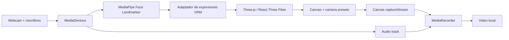

# Arquitectura inicial

**Estado:** propuesta por validar. Arquitectura client-side; despliegue estático. Sin backend ni GPU remota obligatorios.

## Decisiones a verificar

- **Avatar:** probar un VRM/GLB con expresiones compatibles y licencia redistribuible. La conversión de landmarks a rig requiere calibración.
- **Cámara:** permiso explícito en HTTPS; `getUserMedia`; limpieza de tracks al cerrar.
- **Grabación:** video del canvas + audio del micrófono en un `MediaStream`, mediante `MediaRecorder`. Detectar MIME compatible; WebM como objetivo inicial, sin prometer MP4 universal.
- **Rendimiento:** medir FPS, latencia, audio-video y consumo en escritorio y móvil. Reducir calidad visual antes de bloquear la interacción.
- **Persistencia:** memoria de sesión; descarga local. Sin envío de biometría ni grabaciones.
- **Diseño:** vista de actuación sin controles invasivos; tres presets de encuadre e iluminación; estados claros de permiso, carga y grabación.

## Referencias técnicas

- [MediaPipe Face Landmarker (web)](https://github.com/google-ai-edge/mediapipe-samples/tree/main/examples/face_landmarker/js) — detección y demo.
- [Morphix](https://github.com/grep-many/morphix) — webcam → rig VRM (referencia, no dependencia aprobada).
- [TalkingHead](https://github.com/met4citizen/TalkingHead) — lip-sync y avatares, para etapas posteriores.
- [React Three Fiber](https://github.com/pmndrs/react-three-fiber) — renderizado.
- [React Three Examples](https://github.com/pmndrs/react-three-examples) — ejemplos y criterio de implementación.
- [GitHub Spec Kit](https://github.com/github/spec-kit) — estructura de especificaciones.

**Pendientes antes de implementar:** licencia de asset, compatibilidad de grabación por navegador, estrategia de visemas en español y presupuesto de FPS.
